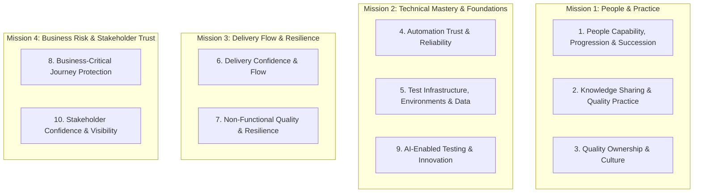

# Strategic Missions & Role Pillars

This framework structures strategic thinking, goals, and activity for the **QA & Test Engineering Manager** role. It groups 10 execution pillars under 4 overarching Strategic Missions.

Use this hierarchy to categorize goals, ground daily choices in Notion, classify achievements, and present strategic direction to leadership.

---

## Slide-Ready Overview

| Strategic Mission | Role Pillars | Objective Lens(es) | Key Strategic Outcome |
|-------------------|--------------|--------------------|----------------------|
| **1. People & Practice** _Empower our people, grow talent, and build a unified quality culture._ | • People Capability, Progression & Succession • Knowledge Sharing & Quality Practice • Quality Ownership & Culture | `People Developer` `Value Creator` `Business Operator` | Motivated team, clear growth paths, active chapter practice, and shared shift-left quality ownership. |
| **2. Technical Mastery & Foundations** _Establish trusted automation, robust test environments/data, and AI capability._ | • Automation Trust & Reliability • Test Infrastructure, Environments & Data • AI-Enabled Testing & Innovation | `Business Operator` `Value Creator` | Fast, deterministic test runs on stable environments with representative data and AI-assisted leverage. |
| **3. Delivery Flow & Resilience** _Accelerate squad velocity while ensuring non-functional resilience and performance._ | • Delivery Confidence & Flow • Non-Functional Quality & Resilience | `Business Operator` `Value Creator` | Smooth flow through QA without bottlenecks, backed by strong NFRs, uptime, and accessibility standards. |
| **4. Business Risk & Stakeholder Trust** _Protect revenue-critical journeys and translate quality into business confidence._ | • Business-Critical Journey Protection • Stakeholder Confidence & Visibility | `Business Operator` `People Developer` | Zero surprise outages on key commercial flows; transparent, data-driven release readiness for stakeholders. |

When updating the table above, please ensure the formatting is kept so that the lines are "aligned" for easy reading (as they are set now)

---

## Strategic Mission 1: People & Practice

> _"Empower our people, grow talent, and build a unified quality culture."_

### Pillar 1: People Capability, Progression & Succession
- **Objective Lens:** `People Developer`
- **JD Anchor:** People Leadership (~25% of role) — line management of 3 Lead QAs, 1:1 coaching, Growth Framework, promotion cases, hiring pipeline.
- **Plan Anchor:** Focus Area: *People*; 1:1 discovery framework; talent pipeline.
- **Leadership Theme:** Theme 1 (*Re-energising the Team*).
- **Core Values:** *Stand Shoulder to Shoulder*, *Make a Difference*.
- **Intent:** Develop and retain high-performing test engineers through clear progression, active coaching, and succession planning.

### Pillar 2: Knowledge Sharing & Quality Practice
- **Objective Lens:** `People Developer`, `Value Creator`
- **JD Anchor:** Quality Standards & Strategy — leading the QA Chapter / Testing Community of Practice, cross-functional knowledge sharing.
- **Plan Anchor:** Focus Area: *Productivity*; rebranding QA Chapter to Testing Chapter (open to all engineering); cross-platform domain sharing (Web, Mobile, Payments).
- **Leadership Theme:** Theme 2 (*Ways of Working*), Theme 4 (*Visibility across engineering*).
- **Core Values:** *Stand Shoulder to Shoulder*, *Play to Win*.
- **Intent:** Prevent siloed knowledge across platforms and translate individual learning into persistent organizational capability.

### Pillar 3: Quality Ownership & Culture
- **Objective Lens:** `Business Operator`, `People Developer`
- **JD Anchor:** Delivery Partnership & Quality Standards — shifting QA from a downstream gatekeeper to a shared engineering discipline; co-owning acceptance criteria in refinement.
- **Plan Anchor:** Focus Area: *Ownership*; shift-left, Dev & QA alignment, acceptance criteria co-definition.
- **Leadership Theme:** Theme 2 (*Ways of Working*).
- **Core Values:** *Stand Shoulder to Shoulder*, *Focus on Detail*.
- **Intent:** Embed quality thinking early in discovery and refinement so that squads co-own quality rather than inspecting it in at the end.

---

## Strategic Mission 2: Technical Mastery & Foundations

> _"Establish trusted automation, robust test environments/data, and AI capability."_

### Pillar 4: Automation Trust & Reliability
- **Objective Lens:** `Business Operator`, `Value Creator`
- **JD Anchor:** Technical Ownership (~30% of role) — full-stack test automation frameworks (Web/Astro, Mobile/.NET MAUI, APIs); CI/CD quality gates.
- **Plan Anchor:** Focus Area: *Automation*; execution visibility per repo, eliminating flaky test packs, establishing trusted automation baselines.
- **Leadership Theme:** Theme 3 (*Value of Automation* — stopping tests from running in the dark).
- **Core Values:** *Focus on Detail*, *Play to Win*.
- **Intent:** Ensure automated suites run predictably, give fast signals, and are trusted by developers and delivery leads.

### Pillar 5: Test Infrastructure, Environments & Data
- **Objective Lens:** `Business Operator`, `Value Creator`
- **JD Anchor:** Technical Ownership — supporting infrastructure: harness services for test accounts, seed data tools, environment parity across UK and international markets.
- **Plan Anchor:** Focus Area: *Automation & Productivity*; preview environment health, test data strategy (Exerp copy-back vs seeded data), automated reseeding.
- **Leadership Theme:** Theme 3 (*Value of Automation*), Theme 2 (*Ways of Working*).
- **Core Values:** *Focus on Detail*, *Play to Win*.
- **Intent:** Provide stable test environments and representative, reproducible test data so test execution is grounded in realistic conditions.

### Pillar 9: AI-Enabled Testing & Innovation
- **Objective Lens:** `Value Creator`, `Business Operator`
- **JD Anchor:** Technical Leadership — AI-driven testing adoption: agentic runs, AI-assisted exploratory testing, defect triage, boilerplate generation from acceptance criteria.
- **Plan Anchor:** Identifying AI champions, running small targeted experiments (test case generation, scope analysis, Appium agentic POC).
- **Leadership Theme:** Theme 3 (*Value of Automation/AI*), Theme 5 (*Innovation*).
- **Core Values:** *Play to Win*, *Make a Difference*.
- **Intent:** Multiply team capacity and eliminate repetitive test authoring tasks using practical, outcome-focused AI tooling.

---

## Strategic Mission 3: Delivery Flow & Resilience

> _"Accelerate squad velocity while ensuring non-functional resilience and performance."_

### Pillar 6: Delivery Confidence & Flow
- **Objective Lens:** `Business Operator`
- **JD Anchor:** Squad & Delivery Partnership (~15% of role) — supporting squad flow, grounding release readiness in data, removing delivery time sinks.
- **Plan Anchor:** Focus Area: *Productivity*; flow of work through QA, Kanban optimization, eliminating wait times/queues, effective Dev-Test practices.
- **Leadership Theme:** Theme 2 (*Ways of Working*).
- **Core Values:** *Play to Win*, *Make a Difference*.
- **Intent:** Eliminate bottlenecks and waiting time in the delivery pipeline so features move smoothly from refinement to production.

### Pillar 7: Non-Functional Quality & Resilience
- **Objective Lens:** `Business Operator`, `Value Creator`
- **JD Anchor:** Quality Standards & Strategy — partnering with Head of SE and Principal SE on uptime, API performance, accessibility (WCAG 2.1 AA), and DORA quality metrics.
- **Plan Anchor:** NFR baselining, observability, integrating DORA quality signals into CI/CD pipelines.
- **Leadership Theme:** Theme 5 (*What Else* — engineering excellence).
- **Core Values:** *Focus on Detail*, *Play to Win*.
- **Intent:** Protect system health, performance, security, and accessibility compliance alongside functional feature delivery.

---

## Strategic Mission 4: Business Risk & Stakeholder Trust

> _"Protect revenue-critical journeys and translate quality into business confidence."_

### Pillar 8: Business-Critical Journey Protection
- **Objective Lens:** `Business Operator`
- **JD Anchor:** Business Stakeholder Engagement — partnering with Finance, payment partners, commercial, and market teams on coverage for revenue and conversion-critical flows.
- **Plan Anchor:** International market coverage mapping, payment subsystem reliability, high-risk release risk management.
- **Leadership Theme:** Theme 4 (*Visibility*), Theme 5 (*Business Risk*).
- **Core Values:** *Focus on Detail*, *Make a Difference*.
- **Intent:** Focus test engineering depth on payment processing, join flows, and commercial journeys that directly affect revenue and member trust.

### Pillar 10: Stakeholder Confidence & Visibility
- **Objective Lens:** `Business Operator`, `People Developer`
- **JD Anchor:** Business Stakeholder Engagement & Reporting (~10% of role) — clear quality posture visibility ahead of releases; translating technical quality into business decision language.
- **Plan Anchor:** Establishing rapport across engineering and commercial leaders, regular coverage cadence with Finance and Commercial teams.
- **Leadership Theme:** Theme 4 (*Visibility & Rapport*).
- **Core Values:** *Make a Difference*, *Stand Shoulder to Shoulder*.
- **Intent:** Give business leaders transparent, data-backed visibility into quality risk so they can make confident release and launch decisions.
