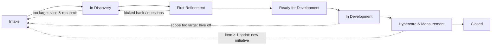

# Software Delivery Lifecycle (Org-Wide Ways Of Working)

This page captures the **agreed, documented** way software and product delivery works across the wider organisation — the initiative lifecycle, ceremonies, metrics, and kanban board that all delivery teams (including QA) operate within.

Unlike [engineering-operating-model.md](engineering-operating-model.md) (my own observations and open questions) and [qa-team-operating-model.md](qa-team-operating-model.md) (how the QA function runs), this file is a **summary of source material provided by others** (leadership decks, org-wide process docs). Treat it as the reference copy of "how we've agreed to work," and update it as newer versions land.

## Status & Sources

This is a living document — process details here are known to evolve (e.g. the 4–6 week initiative sizing guidance was originally initiative-specific but is now being applied more broadly to work in general). When a new source document arrives, update the relevant section and add a dated entry to [Notes / Deviations](#notes--deviations-from-the-documented-process) below rather than silently overwriting prior context.

| Source | Date | Notes |
| --- | --- | --- |
| "Software & Product Delivery at PureGym" deck (GL) | April 2026 | Introduces the initiative lifecycle, stage table, and guiding principles. |
| Ceremonies / Metrics / Kanban Board reference doc | 2026-09 | Team-level ceremonies, flow metrics, and board columns/WIP. |
| Flow-principles sticky notes | 2026-09 | Seven-step summary of how work is pulled and reviewed. |

> ⚠️ **Interim coverage (2026-09-21):** JW and the Product function have left the business. Until a replacement is in place, anywhere below that names JW, Product, Product Owner, or Product Manager as accountable/sign-off is rerouted to **GL / engineering leadership**. Original role names are left in place for reference; watch for this to change again once Product is re-resourced.

## Foundations

- Software is delivered through a structured **initiative lifecycle**, designed to reduce context-switching, minimise cross-team dependencies, and keep work visible from idea to close.
- Each team works on a **maximum of two initiatives at once**, with an ideal of one — supplemented by tech debt, defects, and small changes.
- Initiatives are sized to **4–6 weeks of team effort**, made up of one or more epics, each broken into stories and tasks.
- Work that exceeds this must be **sliced into smaller, standalone deliverable initiatives** — this is a hard target, not a guideline. If a piece of work is too large, it is sliced and resubmitted rather than allowed to run long.

## The Initiative Lifecycle

Initiatives flow through seven stages, from intake through to close. At every stage, a **three-lead group** — Delivery Manager, Product Manager *(interim: GL / engineering)*, and SEM / Principal Engineer — owns the initiative and is responsible for convening the right events, reviews, and conversations to move work forward.

### Stage Overview

| Stage | WIP Limit | Accountable | Purpose | Time Limit |
| --- | --- | --- | --- | --- |
| **Intake** | ∞ | Submitter | Intake bucket for all ideas | None |
| **In Discovery** | 8–10 | Product Owner *(interim: GL / engineering)* | Shaping requirements and epics for incremental delivery | None |
| **Ready for Development** | ∞ | Product Owner *(interim: GL / engineering)* | Queued and confirmed ready — waiting time is tracked and minimised | None |
| **In Development** | 1–2 per team | Delivery Manager | Active delivery by the assigned team | **6 weeks max** |
| **Hypercare & Measurement** | ∞ | Product Owner *(interim: GL / engineering)* | Live monitoring, defect resolution, outcome measurement | ~6 weeks |
| **Closed** | ∞ | N/A | Initiative formally complete and signed off | None |

## Stage Detail

### 01 · Intake

Business, Product, Engineering, or Delivery raises a need via an **IT one pager** (Confluence template). A three-lead group is assigned: Delivery Manager, Product Manager *(interim: GL / engineering)*, SEM / Principal Engineer.

### 02 · In Discovery

Owned by the **Product Owner** *(interim: GL / engineering)* with the three leads. **WIP limit:** up to 10 initiatives in discovery at any time.

Covers: requirements and acceptance criteria, epic definition, architecture/design considerations, stakeholder and comms plan, team assignment, indicative timeline.

> ✅ Sign-off from JW and GL is required before progressing to Ready for Development. *(Interim: sign-off is GL / engineering only, pending a Product replacement.)*

### 03 · First Refinement

The three leads walk the assigned delivery team through the initiative. First epic(s) are broken into deliverable stories. The team may kick back to Discovery with reasonable questions or blockers. Once accepted, the initiative moves to Ready for Development.

### 04 · Ready for Development

Mapped onto the relevant team's board with confirmed start and end dates. Before starting, confirm designs are available and architectural council approval is in place (if required).

> ⏱️ This is a **waiting state** — time here should be tracked and minimised; it surfaces items needing prioritisation.

### 05 · In Development

The Delivery Manager is on point for stakeholder communications throughout delivery.

- **Normal team cadence:** 3 amigos, refinement sessions, daily scrums.
- **Reporting:** a weekly update posted to the initiative ticket covering progress, issues, and risks.

> 🚨 Hard limit: **6 weeks**. If rollout or hypercare is substantial, raise it as its own initiative.

### 06 · Hypercare & Measurement

**Product takes the lead** *(interim: GL / engineering)*, supported by the team and Delivery Manager: outcomes measured against agreed targets, business enablement/training by Product *(interim: engineering)*, defect resolution for live issues.

> 🔁 Any development item estimated at **≥ 1 sprint** must be raised as a **new initiative** back in Intake — it does not extend the current one.

### 07 · Closed

Formally closed after an appropriate hypercare period. All outcomes should be signed off before closure.

## Governance & Alignment

- **Weekly Initiative Review Meeting** — every Tuesday, with Delivery, Product *(interim: GL / engineering)*, and Software Engineering Managers (or Principal Engineers). Reviews progress of all active initiatives across Backlog, Discovery, Ready for Development, In Development, and Done. Primary forum for raising blockers, tracking WIP, and prioritisation decisions.
- **WIP limits** are enforced across the lifecycle to maintain focus and prevent overload. The most critical is **In Development: 1–2 initiatives per team** — this is what drives the requirement for small, well-scoped initiatives.
- The process makes no statement on how long each phase should take, with one exception: **In Development must be no more than six weeks.** At each stage, the three leads are jointly responsible for moving work through with pace and clarity, and own an initiative through to delivery as a team.

## Flow Principles (Team Level)

Summarised from the flow-principles sticky notes:

1. The initiative process is how we feed work longer than 1 week into the backlogs.
2. Work moves to Ready when the Definition of Ready (DoR) is met.
3. Work is pulled in priority order from Ready.
4. Work is pulled when capacity exists (based on WIP limits).
5. Review metrics; identify improvement actions.
6. Track retrospective actions on the kanban board.
7. Regularly demonstrate work DONE.

## Ceremonies

| Ceremony | Purpose |
| --- | --- |
| **Standup** | Walk the board right-to-left. Focus on flow and blockers, not individual status updates. |
| **Three Amigos** | Product *(interim: GL / engineering)*, development, and QA come together to discuss a ticket before it enters refinement — surface assumptions, agree scope, identify edge cases early, so the team is aligned before work starts, not during it. Happens as regularly as possible. |
| **Refinement** | Walk through upcoming work to ensure tickets are well understood, correctly sized, and meet the Definition of Ready. Items that don't pass shouldn't enter the "Ready" queue. This is where future flow is protected. Happens as regularly as possible. |
| **Flow Review & Retrospective** | Review metrics (cycle time, throughput, ageing); spot patterns and identify improvement actions. Inspect the system, not just the people. Use data. Commit to one change at a time. |
| **Replenishment / Prioritisation** | Not a ceremony — happens when work is refined, ready, and the team has capacity to pull in. Can happen in standup, refinement, or ad hoc when needed. |

## Metrics

| Metric | What It Measures | Why It Matters | Action If Trending Wrong | Source Of Truth |
| --- | --- | --- | --- | --- |
| **Cycle Time** | Time from work starting (In Progress) to done. | Tells you how fast your system moves; lower and more consistent is better. | Look for blockers, large items, or stages where work pools up. | Time in Status report |
| **Throughput** | Items completed per period (bi-weekly, aligned to retro). | Reveals sustainable delivery capacity; basis for forecasting. | Investigate why — are items getting bigger, is WIP too high? | Jira transitions to Done |
| **WIP** | Items actively in progress at any point. | High WIP = slow flow, context switching, hidden risk. | Enforce WIP limits — stop starting, start finishing. | Live on the board |
| **Flow Efficiency** | % of cycle time actively worked on vs. waiting. | Most teams are <20% efficient; raising this is where the big gains are. | Find and eliminate waiting states — approvals, handoffs, dependencies. | Time in Status report |
| **Ageing Work Items** | Items in progress longer than historical cycle time suggests. | Surfaces stuck work before it becomes a crisis. | Investigate and unblock immediately; age should be visible on the board. | Board card ageing dots; cross-team escalation report |
| **Blocked Items** | Number and age of items with an explicit blocker. | Blockers kill flow; a rising blocked count = systemic problem. | Escalate, remove the impediment, don't let blockers age. | Red highlight on board, moved back to to-do; cross-team escalation report |

## Kanban Board

| | To-Do | Ready | Dev | Testing | Deploy | Done |
| --- | --- | --- | --- | --- | --- | --- |
| **Purpose** | Items taken from the backlog and being prepared by the team | Refined work in priority order; must be taken from top of list | In Progress / Blocked / Pre-Test Review / Ready for Testing / Dev Testing / Failed QA | Pulled by QA from Ready for Testing (not pushed from Dev) | Ready to deploy or deploying | Deployed and meets DoD |
| **WIP** | – | – | 1.5 per dev | 1 per QA | – | – |

Board rules:

- **No parked status** — tickets move back to Ready (e.g. if someone is sick).
- **Failed QA** status exists for cycle-time reporting.
- **Blocked** items move back to the backlog state unless they'll be unblocked within the day.
- **Test automation** needs to be factored into the ticket — it will block the queue, and devs can help with automation to get it moving.

## Demos

- A recorded demo is encouraged when work reaches Done (even when "technical").
- A Jira field is available for this; demo-worthy items should be agreed and highlighted in refinement.
- A Demo channel in Teams is being created for demos to be shared — a chance to show off exciting work.

## Notes / Deviations From The Documented Process

- 2026-09-21: The 4–6 week sizing guidance is documented as applying to *initiatives*, but in practice it is being used as general sizing guidance for work more broadly, not just formal initiatives.
- 2026-09-21: JW and the Product function have left the business. Until a replacement is in place, all Product Owner / Product Manager accountability, sign-offs, and lead-in-hypercare responsibilities are rerouted to GL / engineering leadership (see inline `(interim: ...)` annotations above). Revisit once Product is re-resourced.
